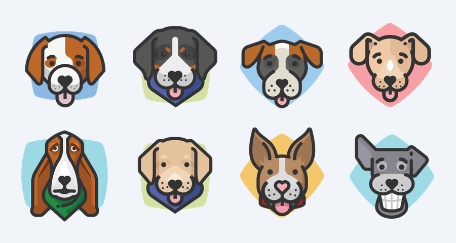
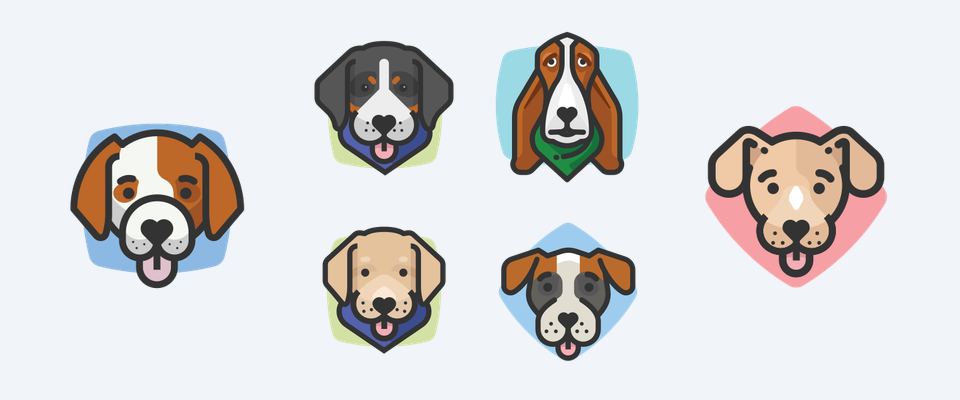
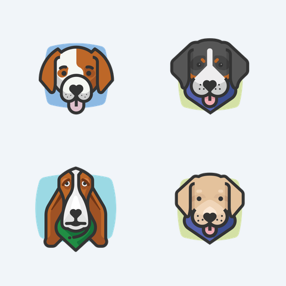

# @atomiclotus/image-composer

Compose a set of images into a single output image using a small layout DSL — grids, side-by-side or stacked regions, and CSS-grid-style track sizing. A pure library (images in, image out — no storage, network, or domain knowledge) with a matching CLI.


```sh
image-composer --layout "1 | 2x3" --col-sizes "2fr 1fr" --width 900 --height 540 \
  --gap 16 --margin 24 --background "#f1f5f9" --out preview.png  feature.png img1.png ... img6.png
```

## Contents

- [Install](#install)
- [Quick start](#quick-start)
- [Layouts by example](#layouts-by-example)
- [Layout notation](#layout-notation)
- [Sizing](#sizing)
- [Spacing](#spacing)
- [How images are placed](#how-images-are-placed)
- [Library API](#library-api)
- [CLI reference](#cli-reference)
- [Output formats](#output-formats)
- [Scope](#scope)

## Install

```sh
npm install @atomiclotus/image-composer
```

Requires Node.js 18 or later. Rendering is backed by [sharp](https://sharp.pixelplumbing.com/), which ships prebuilt binaries for macOS, Linux, and Windows; no native build step is needed on common platforms.

To use the CLI without installing globally:

```sh
npx @atomiclotus/image-composer --help
```

## Quick start

**Library**

```js
const { compositeToFile } = require('@atomiclotus/image-composer');

await compositeToFile({
    images: ['feature.png', 'a.png', 'b.png', 'c.png', 'd.png', 'e.png', 'f.png'],
    layout: '1 | 2x3', // a single feature cell beside a 2x3 grid
    colSizes: '2fr 1fr', // the feature column gets twice the grid's share
    width: 900,
    height: 540,
    gap: 16,
    margin: 24,
    background: '#f1f5f9',
    out: 'preview.png', // format inferred from the extension
});
```

**CLI**

```sh
image-composer --layout "1 | 2x3" --col-sizes "2fr 1fr" --width 900 --height 540 \
  --gap 16 --margin 24 --out preview.png  feature.png a.png b.png c.png d.png e.png f.png
```

Images are listed in **fill order**: the first image goes in the first cell, and so on (see [Fill order](#fill-order)).

## Layouts by example

Every image below was produced by the command shown with it, using the same ten source icons in the same order.

### Grid — `3x3`


```sh
image-composer --layout "3x3" --width 600 --height 600 --gap 16 --margin 24 --out grid.png  img1.png ... img9.png
```

### Single row — `1x4`


```sh
image-composer --layout "1x4" --width 800 --height 240 --gap 16 --margin 24 --out row.png  img1.png ... img4.png
```

### Feature beside a grid — `1 | 2x3`


```sh
image-composer --layout "1 | 2x3" --col-sizes "2fr 1fr" --width 900 --height 540 \
  --gap 16 --margin 24 --out feature-grid.png  feature.png img1.png ... img6.png
```

### Two grids side by side — `2x2 | 2x2`



```sh
image-composer --layout "2x2 | 2x2" --width 900 --height 480 --gap 16 --margin 24 --out pair.png  img1.png ... img8.png
```

### Three regions with weighted columns — `1 | 2x2 | 1`



```sh
image-composer --layout "1 | 2x2 | 1" --col-sizes "1fr 2fr 1fr" --width 960 --height 400 \
  --gap 16 --margin 24 --out triptych.png  left.png img1.png ... img4.png right.png
```

### Feature above a row — `1 / 1x4`


```sh
image-composer --layout "1 / 1x4" --row-sizes "2fr 1fr" --width 640 --height 640 \
  --gap 16 --margin 24 --out stacked.png  feature.png img1.png ... img4.png
```

### Padding inside each cell — `--inset`



```sh
image-composer --layout "2x2" --width 480 --height 480 --gap 16 --margin 24 --inset 24 --out inset.png  img1.png ... img4.png
```

## Layout notation

The layout string describes **structure** only. Sizing and spacing are separate options, so the structure stays readable at a glance.

| Form          | Meaning                                       | Example                  |
| ------------- | --------------------------------------------- | ------------------------ |
| `1`           | a single cell                                 | `1`                      |
| `RxC`         | a grid of `R` rows × `C` columns (rows first) | `3x4`, `1x4`, `4x1`      |
| `A \| B \| …` | regions placed side by side (columns)         | `1 \| 2x3`, `2x2 \| 2x2` |
| `A / B / …`   | regions stacked top to bottom (rows)          | `1 / 1x4`, `1x3 / 1x3`   |

Rules:

- A composite uses **one operator** — `|` or `/`, not both in the same layout.
- Each region is a grid (`RxC`) or a single cell (`1`). Regions cannot themselves contain a split (one level of nesting).
- Whitespace around operators is optional: `1|2x3` and `1 | 2x3` are equivalent.

Invalid layouts are rejected with a descriptive error — for example, grouping with parentheses, mixing `|` and `/`, or a zero/negative dimension.

### Fill order

Images fill cells **region by region**, left to right for `|` and top to bottom for `/`, and **row-major within each region**. For `1 | 2x3`, image 1 is the feature, images 2–4 are the grid's top row, and images 5–7 are its bottom row.

If there are more cells than images, the extra cells are left as background. If there are more images than cells, the extra images are ignored. Control what goes where by ordering the `images` list.

## Sizing

Sizing applies to the **top-level regions of a split**: `colSizes` / `--col-sizes` for a `|` layout and `rowSizes` / `--row-sizes` for a `/` layout. It mirrors CSS `grid-template-columns` / `grid-template-rows`. There must be one track per region; if omitted, every region gets an equal share (`1fr`).

| Track              | Meaning                                                                       | Example                                                    |
| ------------------ | ----------------------------------------------------------------------------- | ---------------------------------------------------------- |
| `fr`               | a flexible share of the free space                                            | `2fr 1fr` — the first region gets twice the second's share |
| `px`               | a fixed length in pixels                                                      | `300px 1fr`                                                |
| `%`                | a percentage of the available length                                          | `60% 40%`                                                  |
| `auto`             | a flexible track of weight 1 (equivalent to `1fr`)                            | `auto 2fr`                                                 |
| `minmax(min, max)` | flexible, floored at `min` and capped at `max` (unbounded when `max` is `fr`) | `minmax(200px, 1fr) 1fr`                                   |

```sh
--col-sizes "2fr 1fr"
--col-sizes "300px 1fr"
--col-sizes "minmax(200px, 1fr) 2fr"
--row-sizes "1fr 2fr"
```

A region's track size sets how large its cells are. Within a region, cells are always equal squares (see [How images are placed](#how-images-are-placed)), so a larger track yields larger images — until the other axis becomes the limit. Each cell is the largest square that fits the region on both axes, so once a region's height (for a `|` split) or width (for a `/` split) is the tighter constraint, widening its track adds space around the images rather than enlarging them.

## Spacing

| Option       | Effect                                                                                             |
| ------------ | -------------------------------------------------------------------------------------------------- |
| `gap`        | space between cells within a region, in px                                                         |
| `margin`     | outer inset of the area used to size the cells, in px                                              |
| `inset`      | padding inside each cell, between the cell edge and the image, in px                               |
| `background` | canvas color — any color sharp accepts, e.g. `#ffffff`, `#f1f5f9`, `rgba(0,0,0,0)` for transparent |

For a split layout, the spacing between regions — and between the outer regions and the image edges — is computed automatically so it is uniform (see below); `margin` affects how large the cells are rather than that spacing.

## How images are placed

1. **Square cells.** Within each region, every cell is a square — the largest that fits the region's rows × columns plus gaps — so all images in a region share one scale. A plain grid's block of cells is centered in the frame.
2. **Fit, never crop.** Each image is scaled to fit inside its cell with its aspect ratio preserved, and centered. Nothing is cropped or distorted.
3. **Even spacing by visible content.** For a split, the regions are spread across the full image so the gutter before the first region, between each pair, and after the last are one equal value. That spacing is measured between the images' **visible content**, not their padded frames: each source's transparent or solid padding is measured and excluded, so icons that carry their own padding still end up evenly spaced. The rule is `gutter = (image width − total visible width of the regions) / (regions + 1)` for a `|` split (heights, for a `/` split).

Compare the feature-beside-grid example above: the space left of the feature, between the feature and the grid, and right of the grid are equal, measured from the visible artwork.

## Library API

```js
const { composite, compositeToFile, compositeToDataUrl } = require('@atomiclotus/image-composer');
```

### `composite(options) → Promise<{ buffer, contentType }>`

Renders the composite and returns the encoded image and its MIME type (`image/png` or `image/webp`).

| Option       | Type                      | Default     | Description                                                                                     |
| ------------ | ------------------------- | ----------- | ----------------------------------------------------------------------------------------------- |
| `images`     | `Array<string \| Buffer>` | `[]`        | Source images (file paths or buffers), in fill order. Any format sharp can read, including SVG. |
| `layout`     | `string`                  | —           | **Required.** The layout string, e.g. `'3x3'` or `'1 \| 2x3'`.                                  |
| `width`      | `number`                  | —           | **Required.** Output width in px.                                                               |
| `height`     | `number`                  | —           | **Required.** Output height in px.                                                              |
| `colSizes`   | `string`                  | equal `1fr` | Track template for a `\|` layout.                                                               |
| `rowSizes`   | `string`                  | equal `1fr` | Track template for a `/` layout.                                                                |
| `gap`        | `number`                  | `0`         | Space between cells, in px.                                                                     |
| `margin`     | `number`                  | `0`         | Outer inset of the sizing area, in px.                                                          |
| `inset`      | `number`                  | `0`         | Padding inside each cell, in px.                                                                |
| `background` | `string`                  | `'#ffffff'` | Canvas color.                                                                                   |
| `format`     | `'png' \| 'webp'`         | `'png'`     | Output format.                                                                                  |

```js
const { buffer, contentType } = await composite({
    images: [fs.readFileSync('a.png'), 'b.png', 'c.png', 'd.png'],
    layout: '2x2',
    width: 480,
    height: 480,
    gap: 16,
    format: 'webp',
});
```

### `compositeToFile(options) → Promise<{ path, contentType }>`

Same options as `composite`, plus `out` (required): the destination path. When `format` is omitted it is inferred from the extension of `out` (`.png` → PNG, `.webp` → WebP; no extension → PNG). An unsupported extension such as `.jpg` is rejected before anything is written.

```js
await compositeToFile({ images, layout: '1x4', width: 800, height: 240, out: 'row.webp' });
```

### `compositeToDataUrl(options) → Promise<string>`

Same options as `composite`; returns a `data:image/png;base64,…` (or WebP) URL, convenient for embedding in HTML.

### Lower-level building blocks

For advanced use, the package also exports `StructureParser` and `SizingParser` (the layout and track-template parsers), `computeGeometry` (layout → cell rectangles), `renderComposite` (cell rectangles + images → encoded image), and `formatFromExtension` (output path → format token).

## CLI reference

```text
image-composer --layout <dsl> --width <px> --height <px> --out <file> [options] <image...>
```

| Option                 | Description                                                    |
| ---------------------- | -------------------------------------------------------------- |
| `--layout <dsl>`       | Layout string, e.g. `"3x4"` or `"1 \| 2x3"`. **Required.**     |
| `--width <px>`         | Output width. **Required.**                                    |
| `--height <px>`        | Output height. **Required.**                                   |
| `--out <file>`         | Output file; format inferred from the extension. **Required.** |
| `--col-sizes <tpl>`    | Track sizes for a `\|` layout, e.g. `"2fr 1fr"`.               |
| `--row-sizes <tpl>`    | Track sizes for a `/` layout.                                  |
| `--gap <px>`           | Space between cells (default `0`).                             |
| `--margin <px>`        | Outer inset of the sizing area (default `0`).                  |
| `--inset <px>`         | Padding inside each cell (default `0`).                        |
| `--background <color>` | Canvas color (default `#ffffff`).                              |
| `--format <png\|webp>` | Override the output format.                                    |
| `-h`, `--help`         | Show help.                                                     |

Image inputs are positional arguments, in fill order. Quote the layout and track templates so the shell does not interpret `|`. On success the CLI prints the written path, size, and content type; on any error it prints the message to stderr and exits with status `1`.

```sh
# WebP output, inferred from the extension
image-composer --layout "2x2" --width 480 --height 480 --gap 16 --out tiles.webp a.png b.png c.png d.png

# Shell globbing supplies the images in alphabetical order
image-composer --layout "3x3" --width 600 --height 600 --gap 16 --margin 24 --out grid.png icons/*.png
```

## Output formats

PNG (default) and WebP. Any other format — passed as `format`, `--format`, or implied by an output extension — is rejected with an `unsupported format` error rather than being silently written as PNG.

## Scope

v1 supports single-operator, one-level layouts with full track sizing. Grouping with parentheses, mixing `|` and `/` in one layout, nesting beyond one level, named grid areas, and `repeat()` / `fit-content()` track sizes are not supported in v1.

Design records: [ADR-001](docs/adr/ADR-001-image-composer/ADR-001-image-composer.md) (the package and layout DSL) and [ADR-002](docs/adr/ADR-002-composite-placement-model/ADR-002-composite-placement-model.md) (the placement model).

## License

MIT
